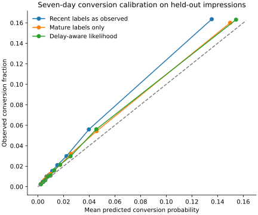
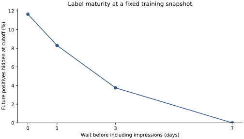

# Seven-day conversion and delayed feedback

This experiment replays what conversion labels were available at one training snapshot. It uses the public Criteo Attribution log and predicts conversion within seven days after an impression. The Sponsored Search archive recommended initially returned HTTP 404 on 2026-11-22, so this run uses the Criteo-hosted Attribution release on Hugging Face.

## Data and label contract

- Source contains 16,468,027 impressions. Deterministic hashing of user ID retains approximately 10% of users and 1,646,997 impressions across the entire log. Each sampled user is retained across time. The compressed file SHA-256, source revision and package versions are in [results.json](results.json).
- A positive has a valid conversion timestamp between impression time and impression time plus seven days. Training positives must also occur by the training snapshot. An unobserved conversion is treated according to the selected label policy. Conversion timestamps proxy event availability because ingestion timestamps are unavailable.
- Features are campaign and cat1–cat9. The hash transformation has 65,536 buckets. Conversion outcomes, attribution, conversion IDs, click positions/counts, costs and future aggregates are excluded from features.
- Training uses impressions before relative day 13.9167. Validation spans days 13.9167–14.9167. Its labels mature before test starts on day 21.9167. Test spans two days, ending at day 23.9167. Another seven days remain for test labels to mature. Models remain frozen between the training snapshot and testing.
- The conversion field can associate one conversion event with several impressions. Metrics weight impression rows, so positive rows are not unique purchases or incremental conversions. User identifiers are used for sampling only.

| Cohort | Impressions | Seven-day positives visible at label cutoff |
| --- | ---: | ---: |
| Recent training | 774,200 | 20,531 |
| Mature training subset | 393,703 | 11,723 |
| Validation | 52,337 | 1,615 |
| Test | 103,581 | 3,319 |

## Comparable models

All three methods use a hashed logistic model, regularization 1e-5 and the same L-BFGS-B optimizer. SGD provides initial coefficients. The mature model uses only training impressions with seven complete observation days. The recent baseline treats conversions still hidden at the cutoff as negatives.

The delay-aware method estimates an empirical conversion-delay CDF F from seven-day positives in the mature training subset. With elapsed time a and eventual conversion probability p, its observed-label probability is q = p × F(min(a, H)), where H is seven days. It minimizes binary cross entropy on q and predicts eventual p at inference. F is clipped to [0.02, 1] for numerical stability. All three optimization runs converged. This global CDF assumes the conditional delay pattern transfers to recent samples.

## Held-out results

| Policy | LogLoss | ROC-AUC | Average precision | ECE (percentage points) |
| --- | ---: | ---: | ---: | ---: |
| Recent labels as observed | 0.116234 | 0.82624 | 0.19578 | 0.732 |
| Wait seven days | 0.116620 | 0.82074 | 0.19058 | 0.442 |
| Delay-aware likelihood | 0.115463 | 0.82638 | 0.19585 | 0.417 |

Validation selected delay-aware likelihood. On 103,581 held-out impressions with 3,319 positive rows, it reduced LogLoss by 0.66% relative to recent labels. The paired change was -0.000771, with hourly block-bootstrap 95% CI [-0.000983, -0.000572]. ECE decreased from 0.732 to 0.417 percentage points. Average precision changed only slightly. The mature-only model had a higher LogLoss than the recent baseline in this run.



## Waiting versus freshness

| Required waiting period | Available training impressions | Eventual positive rows still hidden |
| --- | ---: | ---: |
| 0 days | 774,200 | 11.66% |
| 1 days | 718,543 | 8.30% |
| 3 days | 600,502 | 3.76% |
| 7 days | 393,702 | 0.00% |



Waiting seven days eliminates hidden positives for this seven-day target and retains roughly half as many training impressions. These are different cohorts at one fixed cutoff. The waiting table is descriptive, while the model comparison measures its combined freshness and sample-size trade-off.

## Reproduce

```bash
python -m pip install -r requirements-conversion.txt
bash scripts/download_conversion.sh
OPENBLAS_NUM_THREADS=1 OMP_NUM_THREADS=1 python -m ads.conversion data/conversion/criteo_attribution_dataset.tsv.gz --output runs/conversion
python -m ads.conversion_plots runs/conversion
python -m unittest discover -s tests -p test_conversion.py -v
```

Three tests check as-of label visibility, the horizon-conditional delay CDF, and the analytic likelihood gradient against a numerical derivative.

## Limits and next experiment

One user sample, one training snapshot and one two-day test period are evaluated. The hourly bootstrap has 49 blocks and does not fully capture dependencies across hours or repeated conversions. The global delay CDF ignores campaign-specific delays and reporting latency. Absolute probabilities refer to the released sampled distribution. Revenue, CPA and causal lift are unmeasured. A subsequent step is additional temporal snapshots, campaign-stratified delay modeling and real-model serving benchmarks.

## Source and citation

[Criteo Attribution dataset](https://huggingface.co/datasets/criteo/criteo-attribution-dataset) · [Dataset description](https://ailab.criteo.com/criteo-attribution-modeling-bidding-dataset/) · [Diemert et al., Attribution Modeling Increases Efficiency of Bidding in Display Advertising, 2017](https://arxiv.org/abs/1707.06409). Dataset license is CC BY-NC-SA 4.0. Raw data remains outside Git.
